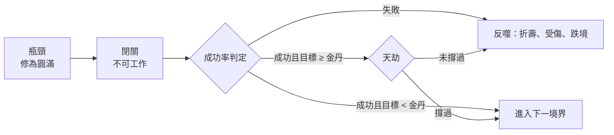

# 《邊緣問道》RimWorld 修仙 Mod 設計文件

Nov 24, 2026 · @Yen-Cheng Kuo

## 概述與設計原則

《邊緣問道》是不依賴任何 DLC 的 RimWorld 修仙 mod：入門容易、越往上越殘酷，最終以飛升離開此界、為殖民地留下傳承作結。

- **入門不稀有**：約九成小人有靈根，人人能碰到 mod 內容。
- **高境界寫實殘酷**：瓶頸、閉關、突破失敗、天劫、心魔都可能致殘或致死。
- **壽元是資源**：可被消耗、可被換取，而非背景數值。
- **科技與修仙並存**：修士強，但不無敵；槍砲仍有意義。
- **為 RimWorld 製造故事**：每個系統都要能產生玩家必須取捨的時刻，而非單純數值成長。

與現有的「邊緣仙路 RimImmortal」系列相比，最大差異是零 DLC 依賴（該系列需 Royalty、Ideology 等 DLC），以及更重視殘酷的突破風險與壽元經濟。

## 範圍與硬性限制

| 項目 | 決定 |
| --- | --- |
| 遊戲版本 | 1.6 stable（開發基準 1.6.4871）；1.7 等轉正式版後再以 LoadFolders 支援 |
| DLC | 不依賴任何 DLC，也不引用任何 DLC 的 Def |
| 前置 mod | 僅 Harmony |
| 語言 | 繁體中文為主（`Languages/ChineseTraditional`）；defName 以英文命名，前綴 `WD_`；packageId `a506415.wendao` |
| 美術 | 先用原版貼圖與改色作佔位 |
| LLM | 本期不做 |
| 安裝路徑 | `RimWorld\Mods\WenDao\` |

需保持距離的原版機制：psycast 與 meditation focus（Royalty）、genes 與 xenotype（Biotech）、儀式與信仰（Ideology）。本體程式碼中的相關類別可用，但 JobDef、AbilityDef 等一律自行定義。

## 靈根系統

靈根在小人生成時決定、終生不變（後期稀有丹藥或奇遇可洗根），決定修煉速度與境界天花板。

| 品階 | 比例 | 修煉速度 | 實際天花板 |
| --- | --- | --- | --- |
| 無靈根（凡人） | 10% | — | 無法修煉 |
| 五靈根、四靈根（偽靈根） | 60% | ×0.4–0.6 | 練氣；靠築基丹有低機率築基 |
| 三靈根、雙靈根 | 25% | ×0.8–1.2 | 金丹～元嬰 |
| 單靈根（天靈根）、異靈根 | 5% | ×1.6–2.0 | 有機會飛升 |

- **屬性**：金、木、水、火、土五行；異靈根為風、雷、冰。屬性影響功法契合度與法術威力。
- **檢測**：新小人的靈根顯示為「未測」，需用測靈盤（建築）檢測後才會揭露。跳過檢測可直接修煉，但不知道該主修哪套功法。
- **生成規則**：殖民者、訪客、敵人皆依比例擲骰。宗門派系成員往高品階偏移，魔修偏好擄人。

## 境界與時間尺度

此界共 6 個大境界；頭級資質加上充足資源，約 10–12 個遊戲年可走到渡劫。RimWorld 一年為 60 天。

| 境界 | 小階 | 頭級資質大約耗時 | 壽元上限（年） | 突破失敗代價 |
| --- | --- | --- | --- | --- |
| 練氣 | 1–9 層 | 數天～數週 | 120 | 輕傷、心情 debuff、折壽 1–3 年 |
| 築基 | 初、中、後期、大圓滿 | 半年～1 年 | 200 | 根基受損（永久 debuff）、折壽 5–10 年 |
| 金丹 | 同上 | 約 2 年 | 400 | 走火入魔（berserk）、境界跌落、折壽 20–50 年 |
| 元嬰 | 同上 | 約 3–4 年 | 800 | 重傷或死亡 |
| 化神 | 同上 | 約 4–5 年 | 1500 | 高機率死亡；元嬰可出竅逃生，留下殘魂道具供奪舍或轉生 |
| 渡劫 | — | 終局事件 | — | 身死道消 |

- 小階之間自動推進，不需閉關；大境界之間才需要突破事件。
- 築基以上的修士，原版老化疾病（白內障、失智等）改為「壽元將盡」前才開始出現。
- **上界設定**：飛升後還有真仙等境界，但此界天道不容，飛升者一律離開地圖，只在傳承與事件中出現。

## 修煉與天地靈氣

修為主要靠打坐累積，速度由靈根、環境靈氣、功法與丹藥相乘決定。

```latex
\text{修為增量/小時} = B \times R \times Q_{\text{環境}} \times T \times P \times M
```

B = 基礎值，R = 靈根倍率，Q = 該格靈氣濃度，T = 功法倍率（含契合度），P = 丹藥 buff，M = 心境係數（由心情換算）。

- **打坐**：新增工作類型「修煉」，在蒲團上執行，玩家可在工作分頁與時間表安排。一般地面也能打坐，效率較低。
- **天地靈氣**：每張地圖有一張靈氣格網（以 overlay 顯示）。世界地圖上的靈脈地格開局濃度較高。
- **提高靈氣**：聚靈陣、靈石、靈脈礦區；大量修士擠在同一區會互相抽取，讓濃度下降。
- **靈氣浮動**：隨機事件靈氣潮汐（全圖暫時升降）、靈脈復甦、靈脈枯竭。
- **真元**：自訂 Need，作為法術與護體罡氣的能量池，從環境靈氣自然恢復。上限隨境界提升。

## 突破流程

大境界突破要依序過瓶頸、閉關、成功率判定；突破至金丹以上還要渡天劫。



閉關期間不能工作，被襲擊或精神崩潰打斷即反噬；護法可提高成功率並壓制心魔。天劫以天氣事件連續雷擊突破者，避雷陣可減傷，其他小人需撤離。

## 壽元作為資源

剩餘壽元 = 境界壽元上限 − 生理年齡 − 累計折壽；歸零即坐化死亡。一局只有十幾年，所以壽元主要靠「折損」而非自然老化來產生壓力。

| 消耗途徑 | 大約代價 |
| --- | --- |
| 突破失敗 | 依境界 1–50 年（見境界表） |
| 燃血、燃壽類秘術 | 每次 3–20 年，換取短時間爆發 |
| 強行突破（沒有感悟也硬衝瓶頸） | 成功也扣 10% 上限 |
| 天劫、心魔重創 | 依傷勢 |
| 煉製本命法寶、為他人止血續命 | 自願消耗 |

| 恢復途徑 | 效果 |
| --- | --- |
| 突破到下一境界 | 上限大幅提高 |
| 延壽丹（稀有靈藥） | +5–30 年，同種丹藥效果遞減 |
| 秘境奇遇 | 隨機 |

設計意圖：老修士「不突破就坐化」、用壽元換一場戰鬥勝利，都是玩家必須做的押注。

## 功法與法術

功法決定修煉倍率與可用法術；每名修士 1 部主修加上至多 2 部輔修。

- **取得**：玉簡道具，用 CompUsable 研讀，需時數天。來源有宗門交易、秘境、擊殺敵修掉落、前人洞府。
- **契合度**：功法屬性與靈根相符時修煉倍率提高；相剋時降低，且突破更容易走火入魔。
- **功法等級**：黃、玄、地、天四階。低階功法有境界上限，要修到更高就得轉修（轉修會損失部分修為）。
- **悟道分支**：主修功法修到圓滿後，二選一進入不同流派（例：劑修選「攻伐」或「護道」）。
- **法術**：用 Core 的 Ability 框架，消耗真元，有冷卻。MVP 先做約 6 個：火球術、金光罩、疾風步、治癒術、御劑、燃血秘術。
- **主動與自動**：征召狀態下玩家手動施放；非征召狀態下只自動使用防禦類法術，避免小人亂燒真元。

**流派（MVP 兩種）**

| 流派 | 定位 | 優勢 | 代價 |
| --- | --- | --- | --- |
| 法修 | 遠程法術輸出 | 真元上限高、法術威力加成 | 肉身脆弱，真元一乾即失去戰力 |
| 體修 | 近戰與抗傷 | 受傷減免、恢復加成、近戰傷害、真元消耗低 | 法術少；體修需額外靡耗食物與藥材 |

體修對靈根的依賴減半（靈根倍率取 1 與原值的平均），讓佔六成的偽靈根小人有一條可走的路。

## 修士限定職業與凡人分工

煉丹、煉器、布陣都需要修士操作（控火與神識）；凡人負責種藥、採礦、護法與一般後勤。

| 職業 | 工作台或建築 | 關鍵技能 | 品質規則 |
| --- | --- | --- | --- |
| 煉丹 | 丹爐 | Medicine + Intellectual + 境界 | 套用原版 quality；技藝不足品相變差，不會完全失敗。高階丹有炸爐機率 |
| 煉器 | 煉器台 | Crafting + 境界 | 套用 quality；本命法寶需消耗壽元 |
| 陣法 | 陣盤（建築） | Construction + Intellectual + 境界 | 陣眼需要靈石供能，斷能即失效 |

- **丹毒**：服丹會累積丹毒（套用 drug tolerance 機制），過量導致修煉減速或經脈受損。
- **靈藥**：新增靈草作物，生長速度受靈氣影響。凡人能種，但稀有靈藥只能在靈脈格或秘境取得。
- **靈石**：新礦物與通貨，可採、可交易、可當陣法燃料、可打坐時消耗以加速修煉。
- 凡人仍可用原版所有工作台，也能拿槍打仗。

## 戰鬥與平衡

修士強，但真元一乾就和凡人一樣會被機槍打死；科技路線全程有用。

- **護體罡氣**：金丹以上解鎖，吸收一定比例的傷害並持續扣真元。對爆炸與穿甲彈效果較差。自寫護盾元件，不用 Royalty 的 low shield。
- **境界壓制**：高境界對低境界有命中與傷害加成，反之亦然。
- **raid points**：用 Harmony patch 把殖民地修士的境界算進襲擊點數，避免「財富低、戰力高」讓遊戲變簡單。
- **敵方修士**：散修、魔修、宗門弟子會混在襲擊中出現，境界隨殖民地最高境界成長。
- **法寶武器**：飛劑等法寶以武器形式存在，攻擊消耗真元，可與槍械互換使用。
- **與 Combat Extended**：本期不處理相容。

## 勢力與事件

新增三類派系，讓修仙世界在世界地圖上有存在感。

| 派系 | 預設關係 | 行為 |
| --- | --- | --- |
| 正道宗門（2–3 個，各有屬性與專長） | 中立 | 交易玉簡、丹藥、靈石；收徒（會來要人）；可結盟 |
| 散修 | 中立～敵對 | 商隊、訪客、小規模劫掠 |
| 魔道宗門 | 敵對 | 襲擊、擄走有靈根的小人、採補風格的吸取修為 |

- **宗門事件**：宗門大比（派人參加換獎勵）、宗門求援、魔修追殺逃難弟子。
- **秘境**：以 quest site 開臨時地圖，限時探索，有守關妖獸、靈藥、玉簡、前人遺骸。
- **奇遇、機緣**：天降異寶（掉落物事件）、前人洞府現世、靈脈復甦。
- **妖獸**：高靈氣地圖出現妖獸版原版動物，內含妖丹（煉丹材料）。靈獸馴服放到後期。

## 師徒、道侶與開局

修士之間的關係會影響修煉效率，也是心境與悲劇的來源。

- **傳道（新工作類型）**：境界較高者在講道台授課，徒弟在旁打坐。徒弟修為與感悟獲得加成，幅度隨師尊境界與 Social 技能提高。首次授課建立「師尊／弟子」關係（自訂 PawnRelationDef）。
- **師徒羈絆**：師尊死亡或飛升時弟子有強烈心情變化；弟子可繼承師尊的主修功法。
- **道侶**：原版情人或配偶關係且雙方皆為修士，即為道侶。
- **雙修**：道侶在靜室共同打坐的工作，雙方修為與心情皆有加成；靈根屬性相生時加成更高。以機制呈現，不描寫親密內容。
- **道侶離世**：除原版喪偶悲傷外，另加「道心受損」，下一次突破成功率降低。
- **開局劇本「落魄宗門」**：1 名築基師尊加 2 名練氣弟子，已有師徒關係；帶蒲團、測靈盤、少量靈石與一部黃階玉簡。原版劇本不受影響，只是小人會擲靈根。

**化神殘魂奪舍**

1. 化神突破失敗時，有機會留下「殘魂」道具，會隨時間消散。
2. 必須有一名俘虜作宿主，由修士執行奪舍。
3. 宿主身體變成殖民者，記憶、技能與功法來自殘魂。
4. 宿主原有人格的影響很輕，影響程度隨兩者境界差減少：境界差小時可能保留宿主 1 個特質或部分技能熱度，境界差大（如凡人宿主）則幾乎無影響。
5. 奪舍後跌一個大境界（化神 → 元嬰）。因為已有該境界的突破體悟，重新突破回原境界時成功率略高，所需感悟略少。

## 飛升終局與傳承

渡劫成功的修士飛升離開地圖，殖民地繼續，並獲得永久傳承。

1. **引劫**：化神大圓滿的修士可主動引劫，亦可拖延；拖太久天劫會自行降臨且更強。
2. **九重天劫**：仿照原版飛船結局的守城，殖民地需撐過數天。期間有連續雷劫、心魔幻境，以及被天劫吸引來的域外天魔大型襲擊。
3. **飛升**：成功後小人離開地圖，不計入死亡，殖民地對其有正面想法。
4. **失敗**：身死道消，留下少量遺物。

傳承（永久，可累積）：

- **仙府遺澤**：飛升地點留下一座建築，全圖靈氣上升，可在此參悟。
- **傳功**：飛升者的主修功法留為可無限研讀的玉簡。
- **仙緣**：此後偶爆「飛升者降下機緣」事件（丹藥、法寶、為後輩指點突破）。
- **紀錄**：飛升者名錄保存在存檔中，傳承內容依飛升者的靈根與主修功法屬性而定。

## 技術架構對照

能用 XML Def 完成的就不寫 C#；C# 只負責原版沒有的邏輯，Harmony patch 當成最後手段。

| 系統 | XML Def | C# |
| --- | --- | --- |
| 靈根 | HediffDef（隱藏）、自訂 Def | 生成小人時擲骰（patch PawnGenerator） |
| 境界、修為 | HediffDef（stages） | HediffComp 計算修為與小階推進 |
| 真元 | NeedDef | Need 子類別 |
| 壽元 | — | ThingComp 或 HediffComp 記錄折壽；patch 老化疾病生成 |
| 天地靈氣 | — | MapComponent（格網）+ overlay 繪製 |
| 打坐、閉關 | WorkTypeDef、WorkGiverDef、JobDef、蒲團 ThingDef | JobDriver |
| 突破、天劫、心魔 | IncidentDef、MentalStateDef | 突破成功率計算、雷擊事件、心魔生成 |
| 功法 | ThingDef（玉簡）+ CompProperties\_Usable、自訂 TechniqueDef | CompUseEffect |
| 法術 | AbilityDef + CompProperties\_AbilityEffect | 真元消耗、自訂效果 |
| 煉丹、煉器 | RecipeDef、工作台 ThingDef、丹藥 ThingDef + ingestible | 修士限定判定、炸爐 |
| 陣法 | 建築 ThingDef | ThingComp（供能、範圍效果、護盾） |
| 護體罡氣 | — | Apparel 或 HediffComp 形式的護盾 |
| 宗門 | FactionDef、PawnKindDef | — |
| raid points | — | Harmony patch StorytellerUtility |
| 飛升 | IncidentDef、GameConditionDef | 守城流程、一個 GameComponent 記錄傳承 |
| 繁中文字 | Languages/ChineseTraditional/DefInjected、Keyed | — |

## 開發分期

每期結束都要能在遊戲裡完整玩一輪，再進入下一期。

1. **Phase 0：骨架**。About.xml、csproj、Harmony 初始化、繁中語言檔結構；遊戲能載入且無紅字。
2. **Phase 1：MVP**。靈根（含測靈盤）、靈氣格網、蒲團打坐、真元、紴氣到金丹、突破與天劫、壽元折損、約 6 個法術、丹爐加 5 種丹、聚靈陣。
3. **Phase 2：世界**。三類派系、敵方修士、raid points patch、玉簡功法與契合度、靈石經濟。
4. **Phase 3：深化**。元嬰、化神、心魔、走火入魔、煉器與法寶武器、護體罡氣、悟道分支。
5. **Phase 4：終局**。渡劫、飛升守城、傳承系統、秘境。
6. **Phase 5：打磨**。妖獸與靈獸、自製貼圖、數值平衡、效能測試、Steam Workshop 發布。

## 開發環境清單

開工前只需裝好下列必裝項目；NuGet 套件在第一次建置時會自動下載。

- [ ] .NET SDK 8 或更新版（專案目標為 `net472`）
- [ ] 編輯器：VS Code + C# Dev Kit、Visual Studio 2022 Community 或 Rider，三選一
- [ ] Git，以及一個 GitHub repo
- [ ] ILSpy（反編譯 `Assembly-CSharp.dll` 以查原版寫法）
- [ ] Steam Workshop 上的 Harmony mod
- [ ] 遊戲內開啟 Development mode

自動取得的 NuGet 套件：`Krafs.Rimworld.Ref`（1.6 參考組件）、`Lib.Harmony`。

repo 實際放在 `D:\WenDao`，並以 junction 連到 `C:\Program Files (x86)\Steam\steamapps\common\RimWorld\Mods\WenDao`。

## 待決事項

已決定：開發改由 Claude Code 在本機進行（2026-11-24）；mod 名稱《邊緣問道》，repo `a506415/WenDao`；新增開局劇本、傳道、道侶雙修；MVP 流派為法修與體修；奪舍需俘虜。

- [ ] 突破成功率與天劫強度的具體數值，留到 Phase 1 實測再調。
